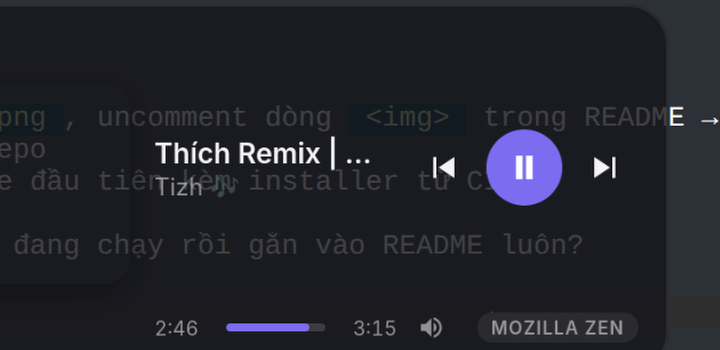

<div align="center">

# 🎵 NowPlay

**A beautiful, lightweight, cross-platform floating mini player.**

Always-on-top • hotkey-toggleable • works with any player


[](https://github.com/kien2803/NowPlay/actions/workflows/ci.yml)

<!-- TODO: screenshot

-->

</div>

---

## ✨ Features

| | |
|---|---|
| 🪟 **Floating window** | Frameless, transparent, rounded, blurred — always on top, draggable, remembers its position |
| 🎛 **Multi-player** | One UI for every player via a common backend trait — no Spotify-only lock-in |
| ⌨ **Global hotkey** | `Ctrl+Shift+Space` toggles the player from anywhere; system tray icon too |
| 👁 **Auto visibility** | Hides when nothing plays, pops in when music starts |
| 🎨 **Accent color** | Extracted from album art and applied to controls & progress |
| 🔊 **Full control** | Prev / play-pause / next, seekable progress bar, volume slider |
| 💊 **Pill mode** | Double-click the album art to collapse into a compact pill |
| 🔒 **KDE lockscreen** | Optional Plasma 6 lockscreen theme: full-screen blurred album-art backdrop ([`extras/kde-lockscreen`](extras/kde-lockscreen)) |

## 🎧 Supported players

| Platform | Backend | Players |
|---|---|---|
| **Linux** | MPRIS2 over D-Bus (native, no subprocess) | Spotify, Firefox, Chrome/Chromium, Zen, VLC, Amberol, Rhythmbox, Elisa, mpv, KDE browser integration, … anything MPRIS |
| **macOS** | AppleScript | Spotify *(Music.app & more planned)* |

When several players are running, the one **actually playing** wins; dedicated music players outrank browsers (e.g. Spotify > YouTube in a browser tab).

## 📦 Install

Prebuilt bundles (AppImage / deb / rpm / dmg) are produced by CI for tagged releases — grab them from [**Releases**](https://github.com/kien2803/NowPlay/releases).

To build from source, see below.

## 🛠 Build from source

**Prerequisites:** Rust (stable), Node.js 20+, pnpm, and the [Tauri system deps](https://v2.tauri.app/start/prerequisites/):

```bash
# Fedora
sudo dnf install -y webkit2gtk4.1-devel libsoup3-devel gtk3-devel \
  openssl-devel libappindicator-gtk3-devel librsvg2-devel \
  atk-devel cairo-devel gdk-pixbuf2-devel pango-devel

# Debian / Ubuntu
sudo apt install -y libwebkit2gtk-4.1-dev libgtk-3-dev libsoup-3.0-dev \
  libayatana-appindicator3-dev librsvg2-dev libdbus-1-dev

# macOS — Xcode Command Line Tools only
xcode-select --install
```

```bash
git clone https://github.com/kien2803/NowPlay.git
cd NowPlay
pnpm install
pnpm tauri dev      # dev mode with hot-reload
pnpm tauri build    # native bundle in src-tauri/target/release/bundle/
```

## ⌨ Usage

| Action | How |
|---|---|
| Show / hide | `Ctrl+Shift+Space`, or click the tray icon |
| Move window | Drag anywhere on the card |
| Seek | Click the progress bar, or `←`/`→` (±5s) |
| Volume | Hover the speaker icon |
| Compact mode | Double-click the album art |
| Quit | Tray menu → Quit |

## 🏗 Architecture

```
src-tauri/src/
├── core/
│   ├── model.rs         # PlayerState, TrackMetadata, PlaybackStatus
│   ├── player.rs        # MediaPlayer + PlayerSource traits (backend-agnostic)
│   └── manager.rs       # PlayerManager — discovery, active-player selection,
│                        #   polls every 500ms, emits `player-state` events
├── platforms/
│   ├── linux/mpris.rs   # MPRIS2 over D-Bus via the `mpris` crate
│   └── macos/spotify.rs # Spotify via one osascript snapshot call
├── commands.rs          # play_pause, next_track, previous_track,
│                        # seek_to, set_volume (Tauri commands)
├── window_pos.rs        # window position persistence
└── lib.rs               # window / tray / global-hotkey setup

src/                     # Svelte 5 frontend (runes)
├── lib/stores.ts        # event stream → stores, auto show/hide
├── lib/PlayerCard.svelte
├── lib/Controls.svelte / ProgressBar.svelte / VolumeControl.svelte
└── lib/accent.ts        # dominant color via fetch + createImageBitmap (no canvas taint)
```

**Why it stays multi-player:** the UI only ever sees `PlayerState` snapshots emitted by `PlayerManager`. Adding a source = implement two traits in `platforms/` + one line in `build_sources()`. No UI changes needed.

## ⚙ Configuration

| What | Where |
|---|---|
| Toggle hotkey | `toggle_shortcut()` — `src-tauri/src/lib.rs` |
| Poll interval | `TICK` — `core/manager.rs` (500 ms) |
| Player priority | `preference_rank()` — `core/manager.rs` |
| Window sizes | `SIZE_FULL` / `SIZE_COMPACT` — `src/App.svelte` |

## 🗺 Roadmap

- [ ] Lyrics panel (lrclib)
- [ ] Settings UI (hotkey, player priority, themes)
- [ ] macOS: Music.app & Media Remote sources
- [ ] Light theme + more palette styles
- [ ] Windows backend (GSMTC / SMTC)

## 🤝 Contributing

Issues and PRs welcome.

- Keep `src-tauri/src/core/` **platform-free** — platform code lives in `platforms/`
- Run before submitting: `pnpm check` and `cargo check --manifest-path src-tauri/Cargo.toml`

## 📄 License

[MIT](LICENSE) © NowPlay contributors
